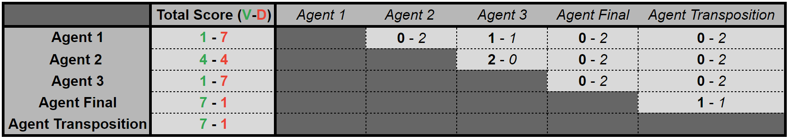

# Abalone AI

An adversarial search agent that plays the board game **Abalone** under a strict time budget, built for the *Artificial Intelligence: Methods and Algorithms* course (INF8175) at Polytechnique Montréal, Fall 2023. The project was graded **20/20**.

> 🎮 A playable browser demo (play against the agent) is planned.

## Highlights

- **Negamax with alpha-beta pruning**, depth 3 in the final agent.
- **Move ordering**: moves that push an opponent marble off the board are explored first, self-sacrifices last. At depth 4, this cut the number of evaluated states from about **70,000 to about 30,000**.
- **Adaptive time management** across the whole game (15 minutes of thinking time per player, 50 turns max).
- **Positional heuristic**: distance to the center, penalty for isolated marbles.
- **Explored, measured, then set aside**:
  - a Zobrist transposition table (2²⁰ entries) with iterative deepening: nearly doubled the reachable depth, but a memory leak pushed RAM usage up to ~30 GB;
  - quiescence search, to mitigate the horizon effect.
- **Iterative, measured approach**: every version instrumented (evaluated states, prunings, time, memory) and compared in an internal round-robin tournament.

## Results

Internal tournament between successive versions of the agent (2 games per pair, wins–losses):



- The final agent and the transposition-table agent both finished **7–1**.
- In the class tournament between teams, the agent reached the final phase.
- Course grade: A*.

## Getting started

Requires Python 3.10.

```bash
pip install -r requirements.txt

# Watch the final agent play against a random player (opens the GUI)
python main_abalone.py -t local my_player.py random_player_abalone.py

# Headless game
python main_abalone.py -t local my_player.py random_player_abalone.py -g

# Play against the agent yourself
python main_abalone.py -t human_vs_computer my_player.py
```

Agents from `experiments/` can be launched the same way, e.g. `python main_abalone.py -t local experiments/my_player_v1.py my_player.py`.

## Repository structure

| Path | Content |
|---|---|
| `my_player.py` | Final agent, as submitted |
| `my_player_transposition.py` | Variant with a Zobrist transposition table and iterative deepening |
| `experiments/` | Intermediate agents (heuristics, time limit, quiescence, transposition tables) and the shared search, heuristic and move-ordering modules |
| `docs/` | Figures and the original development notes (in French) |
| `main_abalone.py`, `board_abalone.py`, `game_state_abalone.py`, `master_abalone.py`, `player_abalone.py`, `random_player_abalone.py`, `GUI/` | Game framework provided by the course |

## Credits

- **Léo Valette** — search algorithm, heuristics, move ordering, experiments, report.
- [oida11](https://github.com/oida11) — contributions to time management and the first transposition table versions.
- The game framework (built on the [`seahorse`](https://pypi.org/project/seahorse/) library) and the GUI were provided by the INF8175 teaching team at Polytechnique Montréal.

## License

The agent code (`my_player*.py`, `experiments/`) is released under the [MIT License](LICENSE). The course-provided framework files listed above are not covered by this license.
